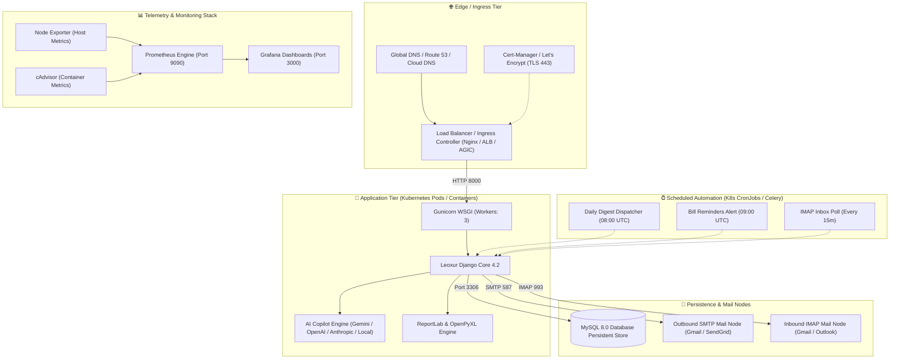

# Leoxur Income Tracker — Enterprise Multi-Cloud, Docker & Kubernetes Deployment Guide

Welcome to the definitive deployment manual for the **Leoxur Income & Expense Tracker**. This document provides step-by-step, production-grade instructions for deploying and orchestrating the Leoxur platform across **Docker Compose**, **Kubernetes (K8s)**, and enterprise **Multi-Cloud environments (AWS, GCP, Azure, and Bare Metal VPS)** with automated SSL, hardware telemetry, and automated background jobs.

---

## 📑 Table of Contents
1. [🏗️ System Architecture & Topologies](#-system-architecture--topologies)
2. [⚙️ Prerequisites & Environment Variables](#%EF%B8%8F-prerequisites--environment-variables)
3. [🐳 Containerized Deployment with Docker Compose](#-containerized-deployment-with-docker-compose)
4. [☸️ Production Kubernetes (K8s) Deployment](#%EF%B8%8F-production-kubernetes-k8s-deployment)
5. [☁️ Multi-Cloud Deployment Playbooks](#%EF%B8%8F-multi-cloud-deployment-playbooks)
   - [Amazon Web Services (AWS EKS & RDS)](#1-amazon-web-services-aws-eks--rds)
   - [Google Cloud Platform (GCP GKE & Cloud SQL)](#2-google-cloud-platform-gcp-gke--cloud-sql)
   - [Microsoft Azure (AKS & MySQL Flexible Server)](#3-microsoft-azure-aks--mysql-flexible-server)
   - [Bare Metal / Self-Hosted VPS (Ubuntu 22.04 LTS)](#4-bare-metal--self-hosted-vps-ubuntu-2204-lts)
6. [🔄 CI/CD Pipeline (GitHub Actions & Container Registry)](#-cicd-pipeline-github-actions--container-registry)
7. [🛡️ Backup, Disaster Recovery & High Availability](#%EF%B8%8F-backup-disaster-recovery--high-availability)
8. [🔍 Troubleshooting & Maintenance Matrix](#-troubleshooting--maintenance-matrix)

---

## 🏗️ System Architecture & Topologies



---

## ⚙️ Prerequisites & Environment Variables

### Core Configuration Parameters

| Variable Name | Required | Default | Description |
| :--- | :---: | :---: | :--- |
| `SECRET_KEY` | **Yes** | — | Cryptographically secure Django secret key |
| `ALLOWED_HOSTS` | **Yes** | `*` | Comma-separated list of valid domain names and IPs |
| `USE_MYSQL` | Optional | `True` | Set `True` for MySQL, `False` for SQLite |
| `DB_NAME` | Optional | `income_tracker` | Database name |
| `DB_USER` | Optional | `leoxur_admin` | Database username |
| `DB_PASSWORD` | **Yes** | — | Database user password |
| `DB_HOST` | Optional | `db` (or `leoxur-mysql`) | Database host address |
| `DB_PORT` | Optional | `3306` | MySQL port |
| `EMAIL_HOST` | Optional | `smtp.gmail.com` | Outgoing SMTP server |
| `EMAIL_PORT` | Optional | `587` | SMTP port (TLS) |
| `EMAIL_HOST_USER` | Optional | — | SMTP login email address |
| `EMAIL_HOST_PASSWORD` | Optional | — | SMTP Google App Password (16 chars) |
| `EMAIL_USE_TLS` | Optional | `True` | Enable TLS encryption |
| `IMAP_HOST` | Optional | `imap.gmail.com` | Inbound IMAP server |
| `IMAP_PORT` | Optional | `993` | IMAP SSL port |
| `IMAP_USER` | Optional | — | IMAP login email address |
| `IMAP_PASSWORD` | Optional | — | IMAP Google App Password |
| `GEMINI_API_KEY` | Optional | — | Google Gemini Pro/Flash API Key |
| `OPENAI_API_KEY` | Optional | — | OpenAI GPT-4o API Key |

---

## 🐳 Containerized Deployment with Docker Compose

Docker Compose runs the entire Leoxur stack—Django, MySQL, Nginx reverse proxy with SSL, Prometheus, Grafana, Node Exporter, and cAdvisor—in isolated containers with zero manual configuration.

### 1. Clone & Configure Secrets
```bash
git clone https://github.com/leoxurDev/LeoxurIncomeTracker.git
cd LeoxurIncomeTracker

# Copy and edit production environment variables
cp .env.example .env 2>/dev/null || cat << 'EOF' > .env
SECRET_KEY=leoxur_super_secret_production_key_change_me_99238123
ALLOWED_HOSTS=tracker.yourdomain.com,localhost,127.0.0.1
USE_MYSQL=True
DB_NAME=income_tracker
DB_USER=leoxur_admin
DB_PASSWORD=SecureProductionDBPass2026!
DB_ROOT_PASSWORD=RootProductionDBPass2026!
DOMAIN_NAME=tracker.yourdomain.com
EMAIL_HOST=smtp.gmail.com
EMAIL_PORT=587
EMAIL_HOST_USER=your_email@gmail.com
EMAIL_HOST_PASSWORD=your_16_char_google_app_password
EMAIL_USE_TLS=True
EOF
```

### 2. Launch the Multi-Container Stack
```bash
# Build and start all 8 services in background
docker-compose up -d --build

# Verify container statuses
docker-compose ps
```

### 3. Initialize Database Migrations & Superuser
```bash
# Wait 10 seconds for MySQL to complete initialization
sleep 10

# Execute database migrations
docker-compose exec web python3 manage.py migrate

# Create your primary administrative account
docker-compose exec web python3 manage.py createsuperuser

# Seed default financial categories
docker-compose exec web python3 seed_data.py
```

### 4. Issue Production SSL Certificates (Let's Encrypt)
Run the automated SSL bootstrap script:
```bash
chmod +x init-ssl.sh
./init-ssl.sh
```

---

## ☸️ Production Kubernetes (K8s) Deployment

All Kubernetes manifests are pre-configured in the `k8s/` directory.

### Manifest File Structure
- [`k8s/namespace.yaml`](file:///Users/hariprasathm/Desktop/LeoxurIncomeTracker/k8s/namespace.yaml): Creates isolated `leoxur` namespace.
- [`k8s/configmap.yaml`](file:///Users/hariprasathm/Desktop/LeoxurIncomeTracker/k8s/configmap.yaml): Environment variables and system endpoints.
- [`k8s/secrets.yaml`](file:///Users/hariprasathm/Desktop/LeoxurIncomeTracker/k8s/secrets.yaml): Sensitive credentials, database passwords, and API keys.
- [`k8s/mysql-statefulset.yaml`](file:///Users/hariprasathm/Desktop/LeoxurIncomeTracker/k8s/mysql-statefulset.yaml): MySQL 8.0 StatefulSet with 20Gi Persistent Volume Claim and health probes.
- [`k8s/app-deployment.yaml`](file:///Users/hariprasathm/Desktop/LeoxurIncomeTracker/k8s/app-deployment.yaml): Zero-downtime RollingUpdate Deployment with 2+ replicas, InitContainers for automatic migrations, and probes.
- [`k8s/app-service.yaml`](file:///Users/hariprasathm/Desktop/LeoxurIncomeTracker/k8s/app-service.yaml): ClusterIP routing traffic on port 80.
- [`k8s/ingress.yaml`](file:///Users/hariprasathm/Desktop/LeoxurIncomeTracker/k8s/ingress.yaml): Production Ingress routing with TLS terminating certificates via cert-manager.
- [`k8s/hpa.yaml`](file:///Users/hariprasathm/Desktop/LeoxurIncomeTracker/k8s/hpa.yaml): Horizontal Pod Autoscaler scaling pods between 2 and 10 based on CPU/RAM load.
- [`k8s/cronjobs.yaml`](file:///Users/hariprasathm/Desktop/LeoxurIncomeTracker/k8s/cronjobs.yaml): Automated CronJobs for daily digests, bill alerts, and IMAP synchronization.
- [`k8s/kustomization.yaml`](file:///Users/hariprasathm/Desktop/LeoxurIncomeTracker/k8s/kustomization.yaml): Kustomize manifest for single-command deployments.

### Deploy in One Command
```bash
# 1. Update your domain and credentials in k8s/secrets.yaml and k8s/ingress.yaml
nano k8s/secrets.yaml
nano k8s/ingress.yaml

# 2. Apply all manifests using Kustomize
kubectl apply -k k8s/

# 3. Monitor rollout status
kubectl rollout status deployment/leoxur-app -n leoxur
kubectl get pods -n leoxur -o wide
```

---

## ☁️ Multi-Cloud Deployment Playbooks

### 1. Amazon Web Services (AWS EKS & RDS)

#### Architecture
- **EKS (Elastic Kubernetes Service)**: Runs web pods and background CronJobs across multiple availability zones.
- **Amazon RDS for MySQL (Multi-AZ)**: Managed high-availability database with automated snapshots and backups.
- **AWS Secrets Manager / IRSA (IAM Roles for Service Accounts)**: Injects secrets without hardcoding credentials into manifests.
- **AWS Load Balancer Controller (ALB Ingress)**: Automatically provisions an AWS Application Load Balancer with AWS Certificate Manager (ACM) SSL.

#### Deployment Steps
```bash
# 1. Provision an EKS Cluster with eksctl
eksctl create cluster \
  --name leoxur-cluster \
  --region us-east-1 \
  --nodegroup-name standard-workers \
  --node-type t3.medium \
  --nodes 3 \
  --nodes-min 2 \
  --nodes-max 6 \
  --managed

# 2. Create RDS MySQL Instance
aws rds create-db-instance \
  --db-instance-identifier leoxur-rds-mysql \
  --db-instance-class db.t3.medium \
  --engine mysql \
  --engine-version 8.0 \
  --allocated-storage 50 \
  --master-username leoxur_admin \
  --master-user-password "YourSuperSecurePassword123!" \
  --db-name income_tracker \
  --multi-az

# 3. Install AWS Load Balancer Controller
helm repo add eks https://aws.github.io/eks-charts
helm install aws-load-balancer-controller eks/aws-load-balancer-controller \
  -n kube-system \
  --set clusterName=leoxur-cluster

# 4. Point k8s/configmap.yaml DB_HOST to RDS endpoint and deploy
kubectl apply -k k8s/
```

---

### 2. Google Cloud Platform (GCP GKE & Cloud SQL)

#### Architecture
- **GKE Autopilot or Standard Cluster**: Managed Kubernetes with automated node upgrading and autoscaling.
- **Cloud SQL for MySQL**: Fully managed MySQL 8.0 with Cloud SQL Auth Proxy sidecar.
- **Google-Managed SSL Certificates**: Automatic provisioning and renewal of Google public certificates on Google Cloud Load Balancer.

#### Deployment Steps
```bash
# 1. Create a GKE Cluster
gcloud container clusters create leoxur-gke \
  --region us-central1 \
  --num-nodes 2 \
  --enable-autoscaling --min-nodes 2 --max-nodes 6 \
  --enable-ip-alias

# 2. Provision Cloud SQL MySQL Instance
gcloud sql instances create leoxur-db-instance \
  --database-version=MYSQL_8_0 \
  --tier=db-custom-2-7680 \
  --region=us-central1 \
  --storage-auto-increase

gcloud sql databases create income_tracker --instance=leoxur-db-instance
gcloud sql users create leoxur_admin --instance=leoxur-db-instance --password="YourSecurePassword123!"

# 3. Connect kubectl to GKE Cluster
gcloud container clusters get-credentials leoxur-gke --region us-central1

# 4. Deploy K8s manifests
kubectl apply -k k8s/
```

---

### 3. Microsoft Azure (AKS & MySQL Flexible Server)

#### Architecture
- **AKS (Azure Kubernetes Service)**: Cloud-native cluster with Azure CNI networking.
- **Azure Database for MySQL (Flexible Server)**: High-performance MySQL storage with zone-redundant high availability.
- **Application Gateway Ingress Controller (AGIC)**: Native Layer 7 load balancer with Web Application Firewall (WAF) integration.

#### Deployment Steps
```bash
# 1. Create Azure Resource Group
az group create --name leoxur-rg --location eastus

# 2. Create AKS Cluster
az aks create \
  --resource-group leoxur-rg \
  --name leoxur-aks \
  --node-count 2 \
  --enable-addons ingress-appgw \
  --appgw-name leoxur-appgw \
  --appgw-subnet-cidr "10.2.0.0/16" \
  --generate-ssh-keys

# 3. Create Azure MySQL Flexible Server
az mysql flexible-server create \
  --resource-group leoxur-rg \
  --name leoxur-mysql-srv \
  --admin-user leoxur_admin \
  --admin-password "YourAzureSecurePassword123!" \
  --sku-name Standard_B2s \
  --tier Burstable \
  --database-name income_tracker

# 4. Get AKS Credentials & Deploy
az aks get-credentials --resource-group leoxur-rg --name leoxur-aks
kubectl apply -k k8s/
```

---

### 4. Bare Metal / Self-Hosted VPS (Ubuntu 22.04 LTS)

For lightweight single-node deployments using **k3s** or **Docker Compose**:

```bash
# Install lightweight k3s
curl -sfL https://get.k3s.io | sh -

# Verify node status
sudo k3s kubectl get nodes

# Deploy Leoxur stack
sudo k3s kubectl apply -k k8s/
```

---

## 🔄 CI/CD Pipeline (GitHub Actions & Container Registry)

To automate container image building and rollout whenever changes are pushed to `main`, use this GitHub Actions workflow `.github/workflows/deploy.yml`:

```yaml
name: Build & Deploy Leoxur

on:
  push:
    branches: [ main ]

jobs:
  build-and-deploy:
    runs-on: ubuntu-latest
    steps:
      - name: Checkout Repository
        uses: actions/checkout@v3

      - name: Log in to GitHub Container Registry (GHCR)
        uses: docker/login-action@v2
        with:
          registry: ghcr.io
          username: ${{ github.actor }}
          password: ${{ secrets.GITHUB_TOKEN }}

      - name: Build & Push Docker Image
        uses: docker/build-push-action@v4
        with:
          context: .
          push: true
          tags: |
            ghcr.io/${{ github.repository_owner }}/leoxur-income-tracker:latest
            ghcr.io/${{ github.repository_owner }}/leoxur-income-tracker:${{ github.sha }}

      - name: Trigger Rolling Update on Kubernetes
        if: env.KUBECONFIG_SECRET != ''
        run: |
          echo "${{ secrets.KUBECONFIG }}" > kubeconfig
          kubectl --kubeconfig=kubeconfig set image deployment/leoxur-app web=ghcr.io/${{ github.repository_owner }}/leoxur-income-tracker:${{ github.sha }} -n leoxur
          kubectl --kubeconfig=kubeconfig rollout status deployment/leoxur-app -n leoxur
```

---

## 🛡️ Backup, Disaster Recovery & High Availability

### Automated MySQL Database Backups
Schedule daily MySQL dumps to secure cloud storage (AWS S3, GCP Cloud Storage, or Azure Blob):
```bash
#!/bin/bash
# Backup script: backup-leoxur-db.sh
DATE=$(date +%Y%m%d_%H%M%S)
BACKUP_FILE="/tmp/leoxur_backup_${DATE}.sql.gz"

# Export dump
docker exec leoxur_db mysqldump -u leoxur_admin -pSecureProductionDBPass2026! income_tracker | gzip > "$BACKUP_FILE"

# Upload to S3 (optional)
# aws s3 cp "$BACKUP_FILE" s3://my-leoxur-backups/

echo "Backup completed: $BACKUP_FILE"
```

### Zero-Downtime Rolling Restarts
```bash
# Gracefully reload Gunicorn workers on Kubernetes
kubectl rollout restart deployment/leoxur-app -n leoxur

# Monitor rollout progression
kubectl rollout status deployment/leoxur-app -n leoxur
```

---

## 🔍 Troubleshooting & Maintenance Matrix

| Symptom | Diagnostic Command | Remediation Action |
| :--- | :--- | :--- |
| **Pod CrashLoopBackOff** | `kubectl logs deployment/leoxur-app -n leoxur --all-containers=true` | Inspect database connection (`wait_for_db.py`) or unapplied migrations. |
| **Database Connection Refused** | `kubectl exec -it deployment/leoxur-app -n leoxur -c web -- python3 wait_for_db.py` | Verify `DB_HOST`, `DB_PORT`, and network policies between pods. |
| **Email Fails to Send / 535 Auth** | `python3 manage.py shell -c "from tracker.views import send_user_mail; ..."` | Confirm 16-character Google App Password without spaces. Enable 2FA on Gmail. |
| **502 Bad Gateway (Nginx)** | `docker logs leoxur_nginx` / `kubectl logs -n leoxur -l app=leoxur-app` | Ensure Gunicorn is listening on `0.0.0.0:8000` inside the container. |
| **Missing Static Files / CSS** | `docker exec -it leoxur_web python3 manage.py collectstatic --noinput` | Ensure `staticfiles` volume is mounted and collectstatic completed. |
| **Certificate Expired** | `kubectl describe certificate leoxur-tls-cert -n leoxur` | Verify cert-manager ClusterIssuer status and DNS A record pointing to ingress IP. |
