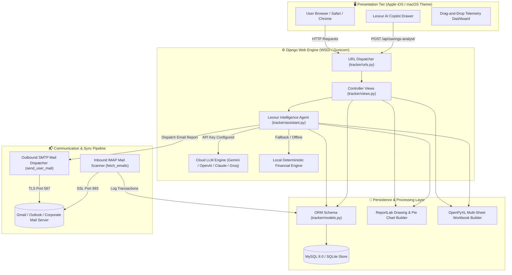

# 🍎 Leoxur Income & Expense Tracker
### Autonomous Financial Telemetry, AI Copilot & Multi-Cloud Ledger Engine

[](https://www.python.org/)
[](https://www.djangoproject.com/)
[](https://www.docker.com/)
[](https://kubernetes.io/)
[](https://opensource.org/licenses/MIT)
[](https://developer.apple.com/design/)

**Leoxur Income & Expense Tracker** is an enterprise-grade personal finance, telemetry, and wealth management platform built with Python and Django. Designed with the precision aesthetics of **Apple iOS / macOS Glassmorphism**, Leoxur combines real-time cashflow analytics, automated ReportLab PDF statements with visual charts, multi-sheet OpenPyXL Excel spreadsheets, an inbound/outbound email synchronization engine (IMAP & SMTP), and an autonomous **AI Copilot** powered by multi-provider LLMs (Google Gemini, OpenAI, Anthropic Claude, Groq, OpenRouter) and an ultra-fast local deterministic financial brain.

---

## 📑 Table of Contents
- [🌟 Key Innovations & Highlights](#-key-innovations--highlights)
- [🏗️ System Architecture & Telemetry Flow](#%EF%B8%8F-system-architecture--telemetry-flow)
- [🤖 Leoxur AI Copilot & Autonomous Agent](#-leoxur-ai-copilot--autonomous-agent)
- [📊 Visual Analytics, Charts & 50/30/20 Blueprints](#-visual-analytics-charts--503020-blueprints)
- [📄 Financial Reports & Document Generation Engine](#-financial-reports--document-generation-engine)
- [📬 Email Node & Automated Pipeline (IMAP & SMTP)](#-email-node--automated-pipeline-imap--smtp)
- [🎨 Apple iOS Design System & Custom Admin](#-apple-ios-design-system--custom-admin)
- [🗂️ Codebase Architecture & Line-by-Line File Directory](#%EF%B8%8F-codebase-architecture--line-by-line-file-directory)
- [🚀 Quickstart & Local Installation](#-quickstart--local-installation)
- [🐳 Production Deployment with Docker Compose](#-production-deployment-with-docker-compose)
- [☸️ Production Deployment on Kubernetes (K8s)](#%EF%B8%8F-production-deployment-on-kubernetes-k8s)
- [☁️ Enterprise Multi-Cloud Playbooks (AWS, GCP, Azure)](#%EF%B8%8F-enterprise-multi-cloud-playbooks-aws-gcp-azure)
- [🔌 REST API & Endpoints Reference](#-rest-api--endpoints-reference)
- [📄 License & Credits](#-license--credits)

---

## 🌟 Key Innovations & Highlights

- **Autonomous AI Copilot**: Conversational finance assistant supporting Google Gemini, OpenAI, Claude, Groq, and OpenRouter with seamless fallback to a zero-latency local deterministic regex brain.
- **Natural Language Execution**: Log multiple transactions (`spent 50 on food, 20 on fuel`), adjust category limits, query 50/30/20 health, or dispatch monthly statements entirely via natural language.
- **Apple Intelligence Welcome Card & Chat Ergonomics**: Full-width input pill, circular send button, 4 one-tap action cards, and client-side Markdown rendering.
- **Multi-Session Chat History**: Create, switch between, and persist multiple conversation threads across browser refreshes using localStorage telemetry.
- **ReportLab PDF Statement Generator**: Generates high-resolution PDF financial statements featuring custom vector Pie Charts, KPI metrics, and transaction itemization.
- **Multi-Sheet OpenPyXL Excel Ledger**: Generates `.xlsx` spreadsheets containing monthly inflow/outflow balance sheets and budget targets.
- **Inbound & Outbound Email Automation**:
  - **IMAP Receipt Syncing**: Automated inbox scanner extracting amounts, categories, and vendors from transaction emails and bank alerts.
  - **SMTP Dispatcher**: Automatically emails monthly PDF statements, spreadsheets, and bill reminders.
- **Live Multi-Currency Scaling**: Dynamically switches currency symbols (`$`, `€`, `₹`, `£`) and re-calculates transactions and budgets using custom user exchange rates.
- **Drag-and-Drop Dashboard Customization**: Reorder telemetry panels (Trends, Ledger, Budgets, Analytics) seamlessly.
- **100% Vanilla CSS Glassmorphism**: High-saturation blur (`backdrop-filter: blur(28px)`), vibrant gradients, SF Pro typography, and Apple SF Symbols without requiring TailwindCSS dependencies.
- **Enterprise Observability**: Full Prometheus metrics collection, Grafana dashboards, Node Exporter, and cAdvisor container telemetry.

---

## 🏗️ System Architecture & Telemetry Flow



---

## 🤖 Leoxur AI Copilot & Autonomous Agent

The **Leoxur AI Copilot** is an autonomous personal finance companion embedded directly in the application.

### Supported Providers & Models
- **Google Gemini**: Gemini 2.5 Flash, Gemini Flash-Lite, Gemini Pro (`gemini_api_key`)
- **OpenAI**: GPT-4o, GPT-4o-mini
- **Groq**: LLaMA-3.3-70b-versatile, Mixtral-8x7b
- **Anthropic**: Claude 3.5 Sonnet
- **OpenRouter**: DeepSeek, Mistral, LLaMA
- **Local Deterministic Brain**: Built-in regex and heuristic financial intelligence operating with zero API key dependencies and zero network latency.

### Autonomous Action Capabilities

| Action Type | Example User Query | Executed Action |
| :--- | :--- | :--- |
| `log_transaction` | *"Spent ₹450 on groceries today"* | Parses amount, category, date, and logs entry into ledger. |
| `log_multiple_transactions` | *"Spent 200 on fuel, 150 on snacks, and 50 on coffee"* | Batch-creates multiple transactions in a single transaction block. |
| `delete_transaction` | *"Delete last transaction"* or *"Remove the 450 grocery bill"* | Deletes latest entry or matches by category and amount. |
| `set_budget` | *"Set food budget to 8000"* | Sets or updates monthly category budget limit. |
| `reset_budgets` | *"Rebalance my budgets to standard 50/30/20"* | Normalizes budget targets to healthy financial benchmarks. |
| `set_reminder` | *"Remind me to pay electric bill 1200 on 2026-11-05"* | Schedules a bill reminder with automated due date tracking. |
| `pay_reminder` | *"Mark electric bill as paid"* | Settles scheduled reminder. |
| `change_currency` | *"Change currency to ₹ with conversion rate 84.5"* | Converts all existing ledger records and budgets using rate. |
| `sync_emails` | *"Check my inbox for bank receipts"* | Polls IMAP node and imports unread transaction receipts. |
| `change_theme` | *"Switch to dark mode"* or *"Switch to light mode"* | Toggles interface theme instantly without reloading. |
| `send_email_report` | *"Email my October report with PDF charts & spreadsheet"* | Generates PDF charts & Excel ledger, emails them as attachments, and provides in-chat download links. |
| `cashflow_audit` | *"Perform 50/30/20 audit and give visual chart"* | Renders visual SVG telemetry blueprint with spending leakages. |

---

## 📊 Visual Analytics, Charts & 50/30/20 Blueprints

Leoxur implements visual telemetry to assess financial health at a glance:

1. **50/30/20 Rule Telemetry**:
   - **50% Needs**: Essential living costs (Rent, Groceries, Utilities).
   - **30% Wants**: Discretionary spending (Dining, Entertainment, Shopping).
   - **20% Savings / Debt**: Surplus capital allocated to investments or emergency funds.
   - Generates an interactive SVG progress bar showing current budget utilization against target limits with an autonomous **Health Score (0–100)**.
2. **Dynamic Cashflow Progression**: Interactive line graphs plotting cumulative inflow vs. outflow throughout the month.
3. **Category Outflow Doughnut**: Breakdown of spending by category with percentage contributions and hover tooltips.
4. **Draggable Cards**: Custom dashboard layout allowing users to rearrange metric cards via smooth drag-and-drop.

---

## 📄 Financial Reports & Document Generation Engine

Leoxur provides built-in programmatic export capabilities without requiring third-party SaaS services:

### 1. ReportLab Vector PDF Statements
- **Vector Pie Charts**: Built with ReportLab graphics shapes, illustrating category spending distribution.
- **KPI Summary Matrix**: Monthly inflow, outflow, net cashflow surplus, and savings rate.
- **Itemized Ledger Table**: Alternating row colors (`#0071E3` headers), formatted currencies, and transaction dates.
- Accessible via `/export/pdf/` and `/export-pdf/`.

### 2. Multi-Sheet Microsoft Excel Workbooks (`.xlsx`)
- Generated with `openpyxl` with styled headers, custom cell borders, and numeric formatting.
- **Sheet 1 — Executive Summary**: High-level financial KPIs.
- **Sheet 2 — Inflows & Outflows**: Full transaction activity log.
- **Sheet 3 — Category Budgets**: Monthly budget allowances vs. actual spending.
- Accessible via `/export/excel/` and `/export-excel/`.

---

## 📬 Email Node & Automated Pipeline (IMAP & SMTP)

### Inbound IMAP Mail Scanner (`tracker/management/commands/fetch_emails.py`)
- Connects securely over SSL (Port 993) to Gmail, Outlook, or corporate IMAP servers.
- Searches for unread receipts and transaction alerts.
- Uses regex parsing to extract:
  - **Amount**: Numerical currency amounts (`$XX.XX`, `₹XX.XX`, etc.).
  - **Vendor / Category**: Matches keywords against categories (Food, Travel, Utilities, Salary).
  - **Type**: Categorizes as income (`credited`, `received`, `deposited`) or expense (`debited`, `spent`, `paid`).
- Deduplicates messages using `ProcessedEmail` (`message_id`) to ensure transactions are never logged twice.
- Dispatches an automated HTML confirmation receipt back to the sender.

### Outbound SMTP Mail Node (`tracker/views.py:send_user_mail`)
- Connects via TLS (Port 587) using user-configured credentials.
- Dispatches multi-part HTML reports with binary attachments (`application/pdf` and `application/vnd.openxmlformats-officedocument.spreadsheetml.sheet`).
- Provides a testing feature in the Settings Modal to verify SMTP and IMAP configurations.

---

## 🎨 Apple iOS Design System & Custom Admin

- **Design System Tokens** ([`tracker/static/css/ios_theme.css`](file:///Users/hariprasathm/Desktop/LeoxurIncomeTracker/tracker/static/css/ios_theme.css)):
  - Apple System Colors: `--apple-blue` (`#0071E3`), `--apple-green` (`#34C759`), `--apple-red` (`#FF3B30`), `--apple-orange` (`#FF9500`), `--apple-purple` (`#AF52DE`).
  - Glassmorphic panels with dynamic blur (`backdrop-filter: blur(28px) saturate(180%)`).
  - Light and Dark Mode system theme synchronizer.
- **Apple SF Symbols Templatetag** ([`tracker/templatetags/apple_icons.py`](file:///Users/hariprasathm/Desktop/LeoxurIncomeTracker/tracker/templatetags/apple_icons.py)):
  - Custom `` syntax rendering crisp, lightweight inline SVG icons.
- **Custom Themed Django Admin** ([`templates/admin/`](file:///Users/hariprasathm/Desktop/LeoxurIncomeTracker/templates/admin/)):
  - Redesigned Django administration interface matching the Apple aesthetic.

---

## 🗂️ Codebase Architecture & Line-by-Line File Directory

```
LeoxurIncomeTracker/
├── Dockerfile                     # Multi-stage Python 3.10 production container spec
├── docker-compose.yml             # 8-service Docker orchestration (Django, MySQL, Nginx, Prometheus, Grafana)
├── requirements.txt               # Production Python dependencies (Django, ReportLab, OpenPyXL, Pillow)
├── manage.py                      # Django execution binary
├── seed_data.py                   # Initial mock transactions, budgets, and categories seeder
├── wait_for_db.py                 # TCP handshake script ensuring database readiness before migrations
├── nginx.conf                     # Nginx reverse proxy template with Let's Encrypt SSL config
├── prometheus.yml                 # Prometheus metrics scraping configuration
├── init-ssl.sh                    # Automated Let's Encrypt SSL certificate issuance script
├── DEPLOYMENT.md                  # Enterprise Multi-Cloud, Docker & Kubernetes Deployment Manual
├── USER_GUIDE.md                  # End-user operational manual
│
├── income_tracker/                # Django Project Root
│   ├── __init__.py
│   ├── settings.py                # Core configuration (MySQL/SQLite toggle, Auth, Static, Templates)
│   ├── urls.py                    # Master URL routing
│   ├── wsgi.py                    # Gunicorn production WSGI gateway
│   └── asgi.py                    # ASGI asynchronous gateway
│
├── tracker/                       # Core Financial Application
│   ├── __init__.py
│   ├── admin.py                   # Django admin model registrations
│   ├── apps.py                    # Application configuration
│   ├── assistant.py               # Leoxur Intelligence Copilot (Cloud AI + Local Deterministic Engine)
│   ├── models.py                  # Database Models (Profile, Transaction, Category, Budget, Reminder)
│   ├── urls.py                    # Application endpoints, export routes, and REST APIs
│   ├── views.py                   # Controllers, export builders, PDF/Excel generators, auth handlers
│   │
│   ├── management/commands/       # Automation & Telemetry Commands
│   │   ├── fetch_emails.py        # IMAP automated receipt scanner and transaction parser
│   │   ├── monitor_system.py      # Hardware CPU, memory, and container health monitor
│   │   ├── send_bill_reminders.py # Scheduled bill alert dispatcher
│   │   └── send_daily_report.py   # Daily financial statement compiler and dispatcher
│   │
│   ├── templatetags/
│   │   ├── __init__.py
│   │   └── apple_icons.py         # Apple SF Symbols inline SVG templatetag
│   │
│   ├── static/                    # Frontend Assets
│   │   ├── css/
│   │   │   └── ios_theme.css      # Core Apple design system, glassmorphism, and responsive layouts
│   │   └── js/
│   │       └── tracker_app.js     # Drag-and-drop dashboard, Chart.js bindings, modals, and copilot UI
│   │
│   └── templates/tracker/         # Glassmorphic View Templates
│       ├── base.html              # Master layout, navigation bar, settings modal, and Copilot drawer
│       ├── dashboard.html         # Main financial telemetry dashboard, charts, ledger, and budget grid
│       ├── login.html             # Apple-style blurred authentication login card
│       └── signup.html            # Registration interface
│
├── templates/admin/               # Apple iOS Custom Themed Django Admin
│   ├── base_site.html             # Custom admin navbar, branding, and typography
│   ├── index.html                 # Admin dashboard model overview
│   └── login.html                 # Custom admin login card
│
└── k8s/                           # Production Kubernetes Manifests
    ├── namespace.yaml             # Dedicated 'leoxur' namespace
    ├── configmap.yaml             # System configurations and non-sensitive environment variables
    ├── secrets.yaml               # Encrypted database passwords, Django keys, and mail credentials
    ├── mysql-statefulset.yaml     # MySQL 8.0 StatefulSet with 20Gi Persistent Volume Claim
    ├── app-deployment.yaml        # Django 2-replica Deployment with rolling updates and probes
    ├── app-service.yaml           # ClusterIP service definition
    ├── ingress.yaml               # Ingress controller routing with cert-manager SSL
    ├── hpa.yaml                   # Horizontal Pod Autoscaler (2–10 pods based on CPU/RAM)
    ├── cronjobs.yaml              # Scheduled CronJobs (Daily report, bill alerts, IMAP fetcher)
    └── kustomization.yaml         # Single-command Kustomize deployment manifest
```

---

## 🚀 Quickstart & Local Installation

### Prerequisites
- Python 3.10, 3.11, or 3.12
- `pip` and `virtualenv`
- MySQL 8.0 (Optional; SQLite is used by default if MySQL is not configured)

### Step-by-Step Setup

1. **Clone the Repository**:
   ```bash
   git clone https://github.com/leoxurDev/LeoxurIncomeTracker.git
   cd LeoxurIncomeTracker
   ```

2. **Create and Activate Virtual Environment**:
   ```bash
   python3 -m venv venv
   source venv/bin/activate
   ```

3. **Install Dependencies**:
   ```bash
   pip install -r requirements.txt
   ```

4. **Initialize Database Schema**:
   ```bash
   python3 manage.py makemigrations
   python3 manage.py migrate
   ```

5. **Create Superuser Account**:
   ```bash
   python3 manage.py createsuperuser
   ```

6. **Seed Initial Mock Data (Optional)**:
   ```bash
   python3 seed_data.py
   ```

7. **Launch Local Development Server**:
   ```bash
   python3 manage.py runserver 127.0.0.1:8000
   ```
   Open your browser to [http://127.0.0.1:8000/](http://127.0.0.1:8000/) and sign in.

---

## 🐳 Production Deployment with Docker Compose

To deploy the entire production stack (Django, MySQL, Nginx, Certbot, Prometheus, Grafana) with a single command:

```bash
# 1. Configure environment variables
cp .env.example .env

# 2. Build and start containers
docker-compose up -d --build

# 3. Apply database migrations
docker-compose exec web python3 manage.py migrate

# 4. Bootstrap Let's Encrypt SSL certificates
chmod +x init-ssl.sh && ./init-ssl.sh
```

---

## ☸️ Production Deployment on Kubernetes (K8s)

Deploy Leoxur on any Kubernetes cluster (EKS, GKE, AKS, or k3s) using the production manifests in [`k8s/`](file:///Users/hariprasathm/Desktop/LeoxurIncomeTracker/k8s/):

```bash
# 1. Update secrets and domain names
nano k8s/secrets.yaml
nano k8s/ingress.yaml

# 2. Deploy the entire stack using Kustomize
kubectl apply -k k8s/

# 3. Verify pod status
kubectl get pods -n leoxur -o wide

# 4. Check horizontal pod autoscaler
kubectl get hpa -n leoxur
```

---

## ☁️ Enterprise Multi-Cloud Playbooks (AWS, GCP, Azure)

For detailed step-by-step instructions on deploying Leoxur across cloud providers:
- **AWS**: Amazon EKS + RDS MySQL + AWS ALB Ingress Controller + S3 Static Storage.
- **GCP**: Google Kubernetes Engine (GKE) + Cloud SQL + Google Managed Certificates.
- **Azure**: Azure Kubernetes Service (AKS) + Azure Database for MySQL Flexible Server + AGIC.
- **Bare Metal / Self-Hosted VPS**: Ubuntu 22.04 LTS with k3s or Docker Compose.

👉 **Refer to the [Complete Multi-Cloud Deployment Manual (DEPLOYMENT.md)](file:///Users/hariprasathm/Desktop/LeoxurIncomeTracker/DEPLOYMENT.md)**.

---

## 🔌 REST API & Endpoints Reference

| Endpoint | Method | Description |
| :--- | :---: | :--- |
| `/api/savings-analyst/` | `POST` | Processes natural language queries for the AI Copilot. Accepts `{ "query": "..." }`. |
| `/api/analytics-data/` | `GET` | Returns monthly income, expense, and category telemetry in JSON format. |
| `/api/reminders/check/` | `GET` | Returns count and details of overdue and upcoming bill reminders. |
| `/export/pdf/` or `/export-pdf/` | `GET` | Downloads the official ReportLab PDF Financial Statement with Pie Charts. |
| `/export/excel/` or `/export-excel/` | `GET` | Downloads the OpenPyXL multi-sheet financial workbook (`.xlsx`). |
| `/export/csv/` | `GET` | Downloads raw transaction records in CSV format. |
| `/export/download-template/` | `GET` | Downloads CSV template for importing external transaction batches. |
| `/export/import-transactions/` | `POST` | Uploads and parses CSV files to batch-insert transactions. |

---

## 📄 License & Credits

- **Author**: Leoxur Development Team
- **Design Language**: Apple Human Interface Guidelines (SF Pro, iOS Glassmorphism)
- **License**: Released under the [MIT License](LICENSE).
